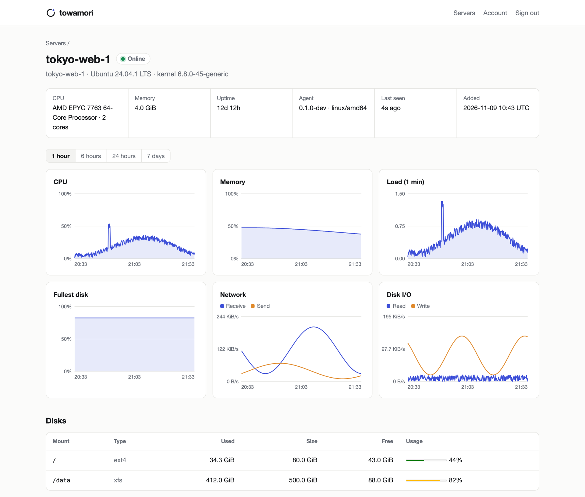
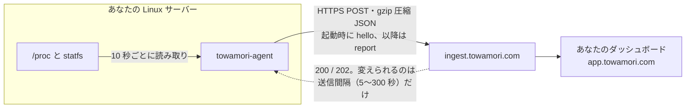

<div align="center">

<picture>
  <source media="(prefers-color-scheme: dark)" srcset="docs/images/banner-dark.svg">
  
</picture>

### 半日あれば全部読める、サーバーエージェント。

[Towamori](https://towamori.com) サーバー監視のオープンソース ホストエージェントです。<br>
Linux サーバーの CPU・メモリ・ディスク・ネットワークの指標を読み取り、HTTPS で送信します。それ以外のことは何もしません。

[](https://github.com/A1oneSKy/towamori/actions/workflows/ci.yml)
[](https://github.com/A1oneSKy/towamori/releases/latest)
[](LICENSE)
[](go.mod)
[](https://github.com/A1oneSKy/towamori/releases/latest)

[English](README.md) · [简体中文](README.zh-CN.md) · **日本語** · [한국어](README.ko.md)

</div>

<br>

| **0** | **0** | **2** | **~1.8k** |
|:---:|:---:|:---:|:---:|
| 待ち受けるポート | サードパーティ依存 | 呼び出すエンドポイント | 行の Go コード（テスト除く） |

## 絶対にしないこと

サーバーに常駐するプログラムを入れるのですから、何ができて何ができないのか、そしてそれぞれを自分で確かめる方法をここに書いておきます。

| | 約束 | 自分で確かめる |
|:---:|---|---|
| 📤 | **外向きの通信だけ。** ポートを一切待ち受けません。 | `sudo ss -ltnup \| grep towamori` の出力は空です。 |
| 🚫 | **リモート操作できない。** コマンドは一切受け付けません。シェルも端末も、依頼に応じたファイルの読み書きもありません。プラットフォーム側が変えられるのは送信間隔（5〜300 秒）だけです。 | プロトコルは `POST` リクエスト 2 種類だけです：[`docs/protocol.md`](docs/protocol.md)（英語）。 |
| 👤 | **root 不要。** systemd ユニットが使い捨ての非特権ユーザーで実行し、システム全体は読み取り専用、メモリ上限は 64 MB です。 | [ユニットファイル](packaging/systemd/towamori-agent.service)の `DynamicUser=yes`、`ProtectSystem=strict`。 |
| 🔢 | **送るのは数値だけ。** プロセス名、コマンドライン、環境変数、ファイルの中身、ログ、ユーザーアカウントは読みません。 | `towamori-agent --once` で送信内容をすべて表示できます。 |
| 🔒 | **トークンを平文で送らない。** 宛先が `localhost` 以外なら、`http://` でトークンを送ることを拒否します。 | `towamori-agent -token x -endpoint http://example.com` は起動を拒否します。 |
| ✅ | **ダウンロードを検証。** インストールスクリプトは SHA-256 を確認してからインストールします。 | [`packaging/install.sh`](packaging/install.sh) を読んでみてください。短いです。 |

## 導入するとこう見えます

<picture>
  <source media="(prefers-color-scheme: dark)" srcset="docs/images/console-dark.png">
  
</picture>

<p align="center"><sub>Towamori ダッシュボードのサーバー画面。データはこのエージェントが送ったものです（デモデータ）。</sub></p>

## 仕組み



- **エンドポイントは 2 つ。** 起動時に一度だけ `hello` でマシンの基本情報を送り、その後は読み取るたびに `report` を送ります。
- **障害時もデータを失わない。** Towamori に届かない間は最大 360 件の読み取り（標準の間隔で 1 時間分）をメモリに保持し、復旧後に古い順に送ります。再試行は指数バックオフです。
- **あえて小さく、地味に。** Go 標準ライブラリのみ、静的バイナリ 1 つ、プラグインなし、自動更新なし。

## クイックスタート

### 1. インストール前に中身を見る

```sh
curl -fsSLO https://github.com/A1oneSKy/towamori/releases/latest/download/towamori-agent_linux_amd64.tar.gz
tar -xzf towamori-agent_linux_amd64.tar.gz towamori-agent
./towamori-agent --once
```

1 秒間隔で 2 回読み取り、`hello` と `report` のリクエスト本文を JSON で表示します。ネットワークには一切触れません。この出力がエージェントの送るものすべてです。（ARM サーバーでは `amd64` を `arm64` に置き換えてください。）

<details>
<summary>出力例（抜粋）</summary>

```json
{
  "hello": {
    "protocol": 1,
    "agent": { "version": "0.1.1", "os": "linux", "arch": "amd64" },
    "host": {
      "hostname": "web-1",
      "machine_id": "3f1c9a0e5b7d2c4a8e6f1b3d5a7c9e0f",
      "os_pretty": "Ubuntu 24.04.1 LTS",
      "kernel": "6.8.0-45-generic",
      "cpu_model": "AMD EPYC 7763 64-Core Processor",
      "cpu_cores": 2,
      "memory_total": 2061135872
    }
  },
  "report": {
    "protocol": 1,
    "samples": [
      {
        "ts": 1794200010,
        "cpu": { "usage": 7.5, "user": 5.0, "system": 2.0, "iowait": 0.25, "steal": 0.25 },
        "load": { "l1": 0.12, "l5": 0.08, "l15": 0.05 },
        "mem": { "total": 2061135872, "available": 1288490188, "used": 772645684 },
        "disks": [{ "mount": "/", "fstype": "ext4", "total": 41943040000, "used": 12582912000 }],
        "disk_io": { "read_bps": 0, "write_bps": 40960 },
        "net": { "rx_bps": 2048.5, "tx_bps": 1024.25 }
      }
    ]
  }
}
```

`machine_id` は生の `/etc/machine-id` ではなく、ソルト付きの SHA-256 です。プラットフォームは、同じトークンが 2 台のマシンで使われていないかを検出するためだけに使います。

</details>

### 2. インストール

systemd が動く Linux サーバー（amd64 または arm64）で、ダッシュボードで発行したトークンを使って：

```sh
curl -fsSL https://raw.githubusercontent.com/A1oneSKy/towamori/main/packaging/install.sh \
  | sudo TOWAMORI_TOKEN=<your token> sh
```

スクリプトは最新リリースをダウンロードし、公開されている SHA-256 チェックサムと照合して `/usr/local/bin` にインストールし、トークンを `/etc/towamori/agent.env`（root のみ読み取り可）に書き込んで `towamori-agent` サービスを起動します。`TOWAMORI_TOKEN` を付けずにもう一度実行すると、既存の設定はそのままでバイナリだけ更新されます。

<details>
<summary><b>手動インストール</b></summary>

1. [最新リリース](https://github.com/A1oneSKy/towamori/releases/latest)から `towamori-agent_linux_<arch>.tar.gz` と `checksums.txt` をダウンロードし、`sha256sum --ignore-missing -c checksums.txt` で照合します。
2. バイナリを `/usr/local/bin/` に置きます。
3. [`packaging/systemd/towamori-agent.service`](packaging/systemd/towamori-agent.service) を `/etc/systemd/system/` にコピーします。
4. `TOWAMORI_TOKEN=<your token>` と書いた `/etc/towamori/agent.env` を作り、所有者を root、権限を `0600` にします。
5. `sudo systemctl enable --now towamori-agent` を実行します。

</details>

<details>
<summary><b>Docker（sudo 不要）</b></summary>

コンテナ内で動かしても、ホストを計測できます：

```sh
mkdir towamori-agent && cd towamori-agent
base=https://github.com/A1oneSKy/towamori/releases/latest/download
curl -fsSLO $base/towamori-agent_linux_amd64.tar.gz
curl -fsSLO $base/checksums.txt
sha256sum --ignore-missing -c checksums.txt
tar -xzf towamori-agent_linux_amd64.tar.gz towamori-agent
curl -fsSLO https://raw.githubusercontent.com/A1oneSKy/towamori/main/packaging/docker/Dockerfile
docker build -t towamori-agent .

printf 'TOWAMORI_TOKEN=%s\n' '<your token>' > agent.env && chmod 600 agent.env
docker run -d --name towamori-agent --restart unless-stopped \
  --pid host --network host --uts host \
  -v /:/host:ro,rslave -e TOWAMORI_HOST_ROOT=/host \
  --env-file agent.env \
  towamori-agent
```

ホストのファイルシステムは読み取り専用でマウントされ、コンテナは `nobody` として動きます。`TOWAMORI_HOST_ROOT` でホストの `/` の場所を伝えると、コンテナではなくホストのマウントテーブルを読みます。

</details>

<details>
<summary><b>状態確認・ログ・アンインストール</b></summary>

```sh
systemctl status towamori-agent
journalctl -u towamori-agent -f
```

アンインストール：

```sh
sudo systemctl disable --now towamori-agent
sudo rm /etc/systemd/system/towamori-agent.service /usr/local/bin/towamori-agent
sudo rm -r /etc/towamori
sudo systemctl daemon-reload
```

</details>

## 設定

コマンドラインフラグ、環境変数、`/etc/towamori/agent.env`（`KEY=VALUE` 形式）の順に読み込みます。

| フラグ | 環境変数 | 既定値 | |
|---|---|---|---|
| `-token` | `TOWAMORI_TOKEN` | | ダッシュボードで発行したエージェントトークン。必須。 |
| `-endpoint` | `TOWAMORI_ENDPOINT` | `https://ingest.towamori.com` | 指標の送信先。 |
| `-interval` | `TOWAMORI_INTERVAL` | `10s` | 収集間隔（5s〜300s）。プランによって別の間隔が指定されることがあります。 |
| `-env-file` | | `/etc/towamori/agent.env` | ファイルがなければ無視します。 |
| `-host-root` | `TOWAMORI_HOST_ROOT` | `/` | コンテナで動かすときの、ホストの `/` のマウント先。 |
| `-once` | | | 1 回だけ読み取って表示し、終了します。トークンもネットワークも不要です。 |
| `-print` | | | 送信するリクエスト本文を標準出力にも表示します。 |
| `-version` | | | バージョンを表示して終了します。 |

> [!TIP]
> トークンは（インストールスクリプトと同じように）env ファイルに置き、`-token` でコマンドラインに渡さないでください。コマンドライン引数は `ps` を通じて、そのマシンの全ユーザーから見えてしまいます。

標準の `HTTPS_PROXY` と `NO_PROXY` 環境変数に従います。

## 収集する情報

| 区分 | 項目 | 読み取り元 |
|---|---|---|
| ホスト（起動時に 1 回） | ホスト名、OS 名とバージョン、カーネル、CPU モデル、コア数、メモリ容量、起動時刻、`/etc/machine-id` のソルト付きハッシュ | `/proc/sys/kernel/*`、`/etc/os-release`、`/proc/cpuinfo`、`/proc/meminfo`、`/proc/stat`、`/etc/machine-id` |
| CPU | 使用率、user、system、iowait、steal（%） | `/proc/stat` |
| ロードアベレージ | 1・5・15 分 | `/proc/loadavg` |
| メモリ | 合計、利用可能、使用中、スワップ合計、スワップ使用中 | `/proc/meminfo` |
| ディスク | 実ファイルシステムごと：マウントポイント、種類、合計、使用中、空き、inode | `/proc/self/mounts`、`statfs(2)` |
| ディスク I/O | 物理ディスク全体の読み書きバイト/秒 | `/proc/diskstats` |
| ネットワーク | インターフェースごとの送受信バイト/秒と合計（VPN トンネルは一覧に出しますが、二重には数えません） | `/proc/net/dev` |
| その他 | 稼働時間、プロセス数（数だけで、一覧ではありません） | `/proc/uptime`、`/proc` |

通信フォーマットの全項目は [`docs/protocol.md`](docs/protocol.md)（英語）にあります。指標の収集は Linux のみです。ほかの OS でも動きますが（開発用）、送るのはホスト情報だけです。

## ソースからビルド

Go 1.22 以降があれば、ほかには何も要りません：

```sh
make test     # go vet + レース検出付きテスト
make build    # このマシン用の bin/towamori-agent
make dist     # dist/：linux/amd64 と linux/arm64 の静的アーカイブ + checksums.txt
```

リリース用バイナリは [GitHub Actions](.github/workflows/release.yml) が最新の安定版 Go でビルドしています。

## ローカルサーバーで開発する

`towamori-devserver` はプラットフォームの小さな代役です。すべてのリクエストをプロトコルと照らし合わせて検査し、読み取りごとに 1 行表示します。

```sh
go run ./cmd/towamori-devserver -token dev
go run ./cmd/towamori-agent -env-file "" -endpoint http://127.0.0.1:8787 -token dev
```

## コントリビュート・セキュリティ・ライセンス

- コントリビュート歓迎です。まず [CONTRIBUTING.md](CONTRIBUTING.md)（英語）をお読みください。依存を増やさない、できることを増やさない、が原則です。
- 脆弱性は [SECURITY.md](SECURITY.md)（英語）の手順で、非公開で報告してください。公開 Issue は立てないでください。
- コードは [Apache License 2.0](LICENSE) で提供しています。
- 「Towamori」の名称とロゴはこのライセンスの対象外です。[TRADEMARKS.md](TRADEMARKS.md)（英語）をご覧ください。

<br>

<div align="center">
<sub><b>towa</b> 永遠 — いつまでも &nbsp;·&nbsp; <b>mori</b> 守り — 見守る</sub>
</div>
