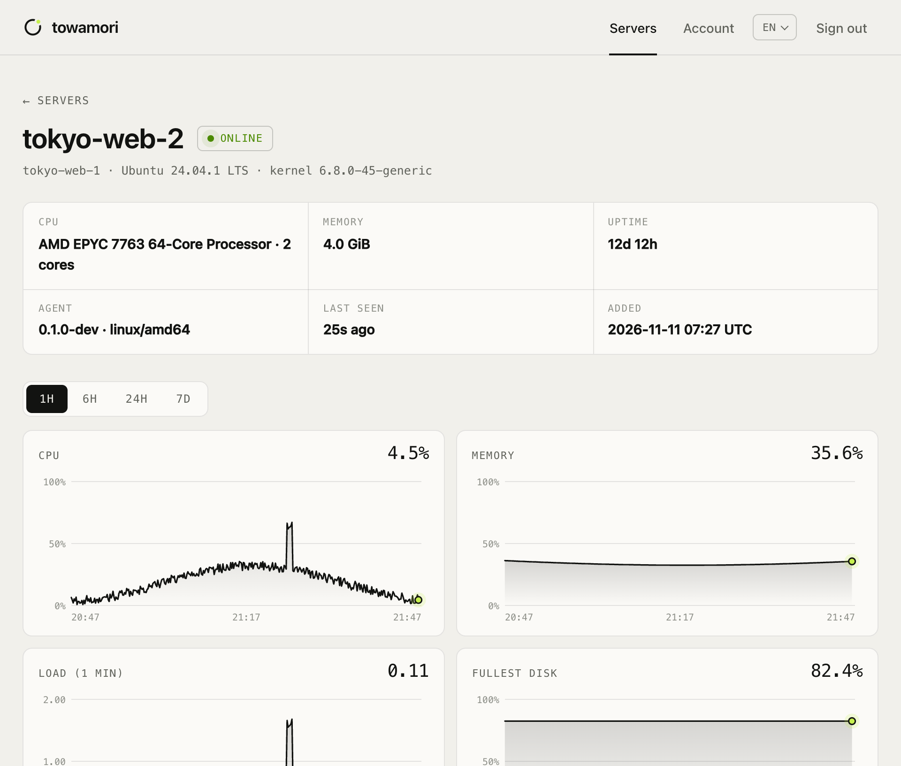
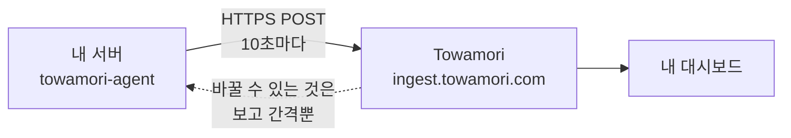

<div align="center">

<picture>
  <source media="(prefers-color-scheme: dark)" srcset="docs/images/banner-dark.svg">
  
</picture>

### 오후 한나절이면 전부 읽을 수 있는 서버 에이전트.

[Towamori](https://towamori.com) 서버 모니터링의 오픈소스 호스트 에이전트입니다.<br>
Linux 서버의 CPU, 메모리, 디스크, 네트워크 지표를 읽어 HTTPS로 보냅니다. 그 밖의 일은 하지 않습니다.

[](https://github.com/A1oneSKy/towamori/actions/workflows/ci.yml)
[](https://github.com/A1oneSKy/towamori/releases/latest)
[](LICENSE)
[](go.mod)
[](https://github.com/A1oneSKy/towamori/releases/latest)

[English](README.md) · [简体中文](README.zh-CN.md) · [日本語](README.ja.md) · **한국어**

</div>

<br>

| **0** | **0** | **2** | **~1.8k** |
|:---:|:---:|:---:|:---:|
| 리슨하는 포트 | 서드파티 의존성 | 호출하는 엔드포인트 | 줄의 Go 코드 (테스트 제외) |

## 절대 하지 않는 일

서버에 상주하는 프로그램을 설치하는 것이니, 무엇을 할 수 있고 무엇을 할 수 없는지, 그리고 각각을 직접 확인하는 방법을 적어 둡니다.

| | 약속 | 직접 확인하기 |
|:---:|---|---|
| 📤 | **아웃바운드 연결만.** 어떤 포트도 리슨하지 않습니다. | `sudo ss -ltnup \| grep towamori`의 출력이 비어 있습니다. |
| 🚫 | **원격 제어 불가.** 어떤 명령도 받지 않습니다. 셸도, 터미널도, 요청에 따른 파일 읽기·쓰기도 없습니다. 플랫폼이 바꿀 수 있는 것은 보고 간격(5~300초)뿐입니다. | 프로토콜 전체가 `POST` 요청 두 종류입니다: [`docs/protocol.md`](docs/protocol.md) (영문). |
| 👤 | **root 불필요.** systemd 유닛이 일회용 비특권 사용자로 실행하며, 시스템 전체는 읽기 전용이고 메모리 상한은 64 MB입니다. | [유닛 파일](packaging/systemd/towamori-agent.service)의 `DynamicUser=yes`, `ProtectSystem=strict`. |
| 🔢 | **숫자만 보냅니다.** 프로세스 이름, 명령줄, 환경 변수, 파일 내용, 로그, 사용자 계정은 읽지 않습니다. | `towamori-agent --once`로 보낼 내용을 전부 출력해 볼 수 있습니다. |
| 🔒 | **토큰을 평문으로 보내지 않음.** 대상이 `localhost`가 아니면 `http://`로 토큰을 보내지 않습니다. | `towamori-agent -token x -endpoint http://example.com`은 시작을 거부합니다. |
| ✅ | **다운로드 검증.** 설치 스크립트는 SHA-256 체크섬을 확인한 뒤에 설치합니다. | [`packaging/install.sh`](packaging/install.sh)를 읽어 보세요. 짧습니다. |

## 설치하면 이렇게 보입니다

<picture>
  <source media="(prefers-color-scheme: dark)" srcset="docs/images/console-dark.png">
  
</picture>

<p align="center"><sub>Towamori 대시보드의 서버 화면. 데이터는 이 에이전트가 보낸 것입니다 (데모 데이터).</sub></p>

## 동작 방식



- **엔드포인트는 두 개.** 시작할 때 한 번 `hello`로 머신의 기본 정보를 보내고, 이후 측정할 때마다 `report`를 보냅니다.
- **장애에도 데이터를 잃지 않음.** Towamori에 닿지 않는 동안 최대 360개의 측정값(기본 간격 기준 1시간 분량)을 메모리에 보관했다가, 복구되면 오래된 것부터 보냅니다. 재시도는 지수 백오프로 합니다.
- **일부러 작고 단순하게.** Go 표준 라이브러리만, 정적 바이너리 하나, 플러그인 없음, 자동 업데이트 없음.

## 빠른 시작

### 1. 설치하기 전에 먼저 보기

```sh
curl -fsSLO https://github.com/A1oneSKy/towamori/releases/latest/download/towamori-agent_linux_amd64.tar.gz
tar -xzf towamori-agent_linux_amd64.tar.gz towamori-agent
./towamori-agent --once
```

1초 간격으로 두 번 측정해 `hello`와 `report` 요청 본문을 JSON으로 출력합니다. 네트워크는 전혀 사용하지 않습니다. 이 출력이 에이전트가 보내는 전부입니다. (ARM 서버에서는 `amd64` 대신 `arm64`를 쓰세요.)

<details>
<summary>출력 예시 (일부 생략)</summary>

```json
{
  "hello": {
    "protocol": 1,
    "agent": { "version": "0.1.1", "os": "linux", "arch": "amd64" },
    "host": {
      "hostname": "web-1",
      "machine_id": "3f1c9a0e5b7d2c4a8e6f1b3d5a7c9e0f",
      "os_pretty": "Ubuntu 24.04.1 LTS",
      "kernel": "6.8.0-45-generic",
      "cpu_model": "AMD EPYC 7763 64-Core Processor",
      "cpu_cores": 2,
      "memory_total": 2061135872
    }
  },
  "report": {
    "protocol": 1,
    "samples": [
      {
        "ts": 1794200010,
        "cpu": { "usage": 7.5, "user": 5.0, "system": 2.0, "iowait": 0.25, "steal": 0.25 },
        "load": { "l1": 0.12, "l5": 0.08, "l15": 0.05 },
        "mem": { "total": 2061135872, "available": 1288490188, "used": 772645684 },
        "disks": [{ "mount": "/", "fstype": "ext4", "total": 41943040000, "used": 12582912000 }],
        "disk_io": { "read_bps": 0, "write_bps": 40960 },
        "net": { "rx_bps": 2048.5, "tx_bps": 1024.25 }
      }
    ]
  }
}
```

`machine_id`는 원본 `/etc/machine-id`가 아니라 솔트를 붙인 SHA-256입니다. 플랫폼은 같은 토큰이 두 대의 머신에서 쓰이는지 알아차리는 데에만 사용합니다.

</details>

### 2. 설치

systemd가 있는 Linux 서버(amd64 또는 arm64)에서, 대시보드에서 받은 토큰으로:

```sh
curl -fsSL https://raw.githubusercontent.com/A1oneSKy/towamori/main/packaging/install.sh \
  | sudo TOWAMORI_TOKEN=<your token> sh
```

스크립트는 최신 릴리스를 내려받아 공개된 SHA-256 체크섬과 대조한 뒤 `/usr/local/bin`에 설치하고, 토큰을 `/etc/towamori/agent.env`(root만 읽을 수 있음)에 기록한 다음 `towamori-agent` 서비스를 시작합니다. `TOWAMORI_TOKEN` 없이 다시 실행하면 기존 설정은 그대로 두고 바이너리만 업그레이드합니다.

<details>
<summary><b>수동 설치</b></summary>

1. [최신 릴리스](https://github.com/A1oneSKy/towamori/releases/latest)에서 `towamori-agent_linux_<arch>.tar.gz`와 `checksums.txt`를 내려받아 `sha256sum --ignore-missing -c checksums.txt`로 대조합니다.
2. 바이너리를 `/usr/local/bin/`에 둡니다.
3. [`packaging/systemd/towamori-agent.service`](packaging/systemd/towamori-agent.service)를 `/etc/systemd/system/`에 복사합니다.
4. `TOWAMORI_TOKEN=<your token>`을 적은 `/etc/towamori/agent.env`를 만들고, 소유자는 root, 권한은 `0600`으로 합니다.
5. `sudo systemctl enable --now towamori-agent`를 실행합니다.

</details>

<details>
<summary><b>Docker (sudo 불필요)</b></summary>

컨테이너 안에서 실행해도 호스트를 측정할 수 있습니다:

```sh
mkdir towamori-agent && cd towamori-agent
base=https://github.com/A1oneSKy/towamori/releases/latest/download
curl -fsSLO $base/towamori-agent_linux_amd64.tar.gz
curl -fsSLO $base/checksums.txt
sha256sum --ignore-missing -c checksums.txt
tar -xzf towamori-agent_linux_amd64.tar.gz towamori-agent
curl -fsSLO https://raw.githubusercontent.com/A1oneSKy/towamori/main/packaging/docker/Dockerfile
docker build -t towamori-agent .

printf 'TOWAMORI_TOKEN=%s\n' '<your token>' > agent.env && chmod 600 agent.env
docker run -d --name towamori-agent --restart unless-stopped \
  --pid host --network host --uts host \
  -v /:/host:ro,rslave -e TOWAMORI_HOST_ROOT=/host \
  --env-file agent.env \
  towamori-agent
```

호스트 파일 시스템은 읽기 전용으로 마운트되고, 컨테이너는 `nobody`로 실행됩니다. `TOWAMORI_HOST_ROOT`로 호스트의 `/`가 어디 있는지 알려 주면, 컨테이너가 아니라 호스트의 마운트 테이블을 읽습니다.

</details>

<details>
<summary><b>상태 확인, 로그, 제거</b></summary>

```sh
systemctl status towamori-agent
journalctl -u towamori-agent -f
```

제거:

```sh
sudo systemctl disable --now towamori-agent
sudo rm /etc/systemd/system/towamori-agent.service /usr/local/bin/towamori-agent
sudo rm -r /etc/towamori
sudo systemctl daemon-reload
```

</details>

## 설정

명령줄 플래그, 환경 변수, `/etc/towamori/agent.env`(`KEY=VALUE` 형식) 순서로 읽습니다.

| 플래그 | 환경 변수 | 기본값 | |
|---|---|---|---|
| `-token` | `TOWAMORI_TOKEN` | | 대시보드에서 받은 에이전트 토큰. 필수. |
| `-endpoint` | `TOWAMORI_ENDPOINT` | `https://ingest.towamori.com` | 지표를 보낼 곳. |
| `-interval` | `TOWAMORI_INTERVAL` | `10s` | 수집 간격, 5s~300s. 요금제에 따라 다른 간격이 지정될 수 있습니다. |
| `-env-file` | | `/etc/towamori/agent.env` | 파일이 없으면 무시합니다. |
| `-host-root` | `TOWAMORI_HOST_ROOT` | `/` | 컨테이너에서 실행할 때 호스트의 `/`가 마운트된 위치. |
| `-once` | | | 한 번 측정해 출력하고 종료합니다. 토큰도 네트워크도 필요 없습니다. |
| `-print` | | | 보내는 요청 본문을 표준 출력에도 출력합니다. |
| `-version` | | | 버전을 출력하고 종료합니다. |

> [!TIP]
> 토큰은 (설치 스크립트처럼) env 파일에 두고, `-token`으로 명령줄에 넘기지 마세요. 명령줄 인수는 `ps`를 통해 그 머신의 모든 사용자에게 보입니다.

표준 `HTTPS_PROXY`, `NO_PROXY` 환경 변수를 따릅니다.

## 수집하는 정보

| 구분 | 항목 | 읽는 곳 |
|---|---|---|
| 호스트 (시작 시 1회) | 호스트 이름, OS 이름과 버전, 커널, CPU 모델, 코어 수, 메모리 크기, 부팅 시각, `/etc/machine-id`의 솔트 해시 | `/proc/sys/kernel/*`, `/etc/os-release`, `/proc/cpuinfo`, `/proc/meminfo`, `/proc/stat`, `/etc/machine-id` |
| CPU | 사용률, user, system, iowait, steal (%) | `/proc/stat` |
| 부하 | 1·5·15분 평균 부하 | `/proc/loadavg` |
| 메모리 | 전체, 사용 가능, 사용 중, 스왑 전체, 스왑 사용 중 | `/proc/meminfo` |
| 디스크 | 실제 파일 시스템별: 마운트 지점, 종류, 전체, 사용 중, 여유, inode | `/proc/self/mounts`, `statfs(2)` |
| 디스크 I/O | 물리 디스크 전체의 읽기·쓰기 바이트/초 | `/proc/diskstats` |
| 네트워크 | 인터페이스별 수신·송신 바이트/초와 합계 (VPN 터널은 목록에 나오지만 중복 집계하지 않음) | `/proc/net/dev` |
| 기타 | 가동 시간, 프로세스 수 (개수만, 목록이 아님) | `/proc/uptime`, `/proc` |

전송 형식은 필드별로 [`docs/protocol.md`](docs/protocol.md) (영문)에 모두 적혀 있습니다. 지표는 Linux에서만 수집합니다. 다른 OS에서도 실행은 되지만(개발용) 호스트 정보만 보냅니다.

## 소스에서 빌드

Go 1.22 이상만 있으면 됩니다:

```sh
make test     # go vet + 레이스 검출기를 켠 테스트
make build    # 이 머신용 bin/towamori-agent
make dist     # dist/: linux/amd64, linux/arm64 정적 아카이브 + checksums.txt
```

릴리스 바이너리는 [GitHub Actions](.github/workflows/release.yml)가 최신 안정 버전 Go로 빌드합니다.

## 로컬 서버로 개발하기

`towamori-devserver`는 플랫폼을 대신하는 작은 서버입니다. 모든 요청을 프로토콜과 대조해 검사하고, 측정값마다 한 줄씩 출력합니다.

```sh
go run ./cmd/towamori-devserver -token dev
go run ./cmd/towamori-agent -env-file "" -endpoint http://127.0.0.1:8787 -token dev
```

## 기여, 보안, 라이선스

- 기여를 환영합니다. 먼저 [CONTRIBUTING.md](CONTRIBUTING.md) (영문)를 읽어 주세요. 의존성을 늘리지 않고, 할 수 있는 일을 늘리지 않는 것이 원칙입니다.
- 취약점은 [SECURITY.md](SECURITY.md) (영문)에 적힌 대로 비공개로 알려 주세요. 공개 이슈는 열지 말아 주세요.
- 코드는 [Apache License 2.0](LICENSE)으로 제공됩니다.
- 'Towamori' 이름과 로고는 이 라이선스에 포함되지 않습니다. [TRADEMARKS.md](TRADEMARKS.md) (영문)를 참고하세요.

<br>

<div align="center">
<sub><b>towa</b> 永遠 — 영원히 &nbsp;·&nbsp; <b>mori</b> 守り — 지켜보다</sub>
</div>
