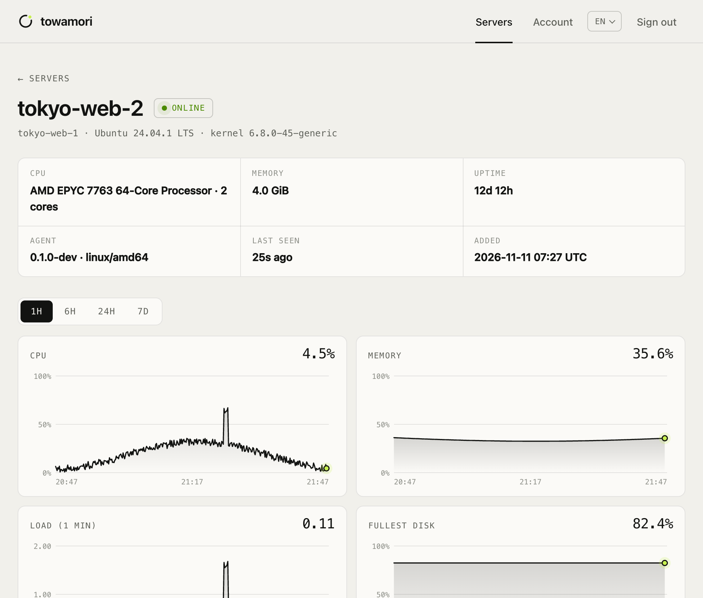
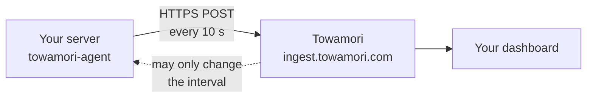

<div align="center">

<picture>
  <source media="(prefers-color-scheme: dark)" srcset="docs/images/banner-dark.svg">
  
</picture>

Sends a Linux server's CPU, memory, disk and network to [Towamori](https://towamori.com).

**English** · [简体中文](README.zh-CN.md) · [日本語](README.ja.md) · [한국어](README.ko.md)

</div>

## Install

1. Run this on the server (Linux with systemd, amd64 or arm64):

   ```sh
   curl -fsSL https://app.towamori.com/install.sh | sudo sh
   ```

2. It prints a pairing code. In the [Towamori console](https://app.towamori.com), click **Add server** and enter the code.

That's it. The server shows up a few seconds later, named after its hostname.

For scripts: add `TOWAMORI_TOKEN=<token>` after `sudo` to skip the code (the console makes such a command too).

Run the same command again to upgrade; your settings are kept.

<details>
<summary><b>Manual install</b></summary>

1. Download `towamori-agent_linux_<arch>.tar.gz` and `checksums.txt` from the [latest release](https://github.com/A1oneSKy/towamori/releases/latest) and check them with `sha256sum --ignore-missing -c checksums.txt`.
2. Put the binary in `/usr/local/bin/`.
3. Copy [`packaging/systemd/towamori-agent.service`](packaging/systemd/towamori-agent.service) to `/etc/systemd/system/`.
4. Create `/etc/towamori/agent.env` containing `TOWAMORI_TOKEN=<your token>`, owned by root with mode `0600`.
5. Run `sudo systemctl enable --now towamori-agent`.

</details>

<details>
<summary><b>Docker (no sudo needed)</b></summary>

The agent can run in a container and still measure the host:

```sh
mkdir towamori-agent && cd towamori-agent
base=https://github.com/A1oneSKy/towamori/releases/latest/download
curl -fsSLO $base/towamori-agent_linux_amd64.tar.gz
curl -fsSLO $base/checksums.txt
sha256sum --ignore-missing -c checksums.txt
tar -xzf towamori-agent_linux_amd64.tar.gz towamori-agent
curl -fsSLO https://raw.githubusercontent.com/A1oneSKy/towamori/main/packaging/docker/Dockerfile
docker build -t towamori-agent .

printf 'TOWAMORI_TOKEN=%s\n' '<your token>' > agent.env && chmod 600 agent.env
docker run -d --name towamori-agent --restart unless-stopped \
  --pid host --network host --uts host \
  -v /:/host:ro,rslave -e TOWAMORI_HOST_ROOT=/host \
  --env-file agent.env \
  towamori-agent
```

The host's filesystem is mounted read-only, and the container runs as `nobody`. `TOWAMORI_HOST_ROOT` tells the agent where the host's `/` is, so it reads the host's mount table instead of the container's.

</details>

<details>
<summary><b>Check, logs and uninstall</b></summary>

```sh
systemctl status towamori-agent
journalctl -u towamori-agent -f
```

Uninstall:

```sh
sudo systemctl disable --now towamori-agent
sudo rm /etc/systemd/system/towamori-agent.service /usr/local/bin/towamori-agent
sudo rm -r /etc/towamori
sudo systemctl daemon-reload
```

</details>

## What you get

<picture>
  <source media="(prefers-color-scheme: dark)" srcset="docs/images/console-dark.png">
  
</picture>

<p align="center"><sub>A server in the Towamori dashboard, fed by this agent (demo data).</sub></p>

## What it will never do

- **Outbound only.** Opens no ports.
- **No remote control.** Can't run commands or touch files.
- **No root.** Runs as a throwaway unprivileged user.
- **Numbers only.** No process names, files or logs.
- **No plain-text tokens.** Refuses `http://` except to localhost.
- **Verified downloads.** The installer checks SHA-256.

<details>
<summary><b>How to check each one yourself</b></summary>

| Promise | Check it yourself |
|---|---|
| Outbound only. | `sudo ss -ltnup \| grep towamori` prints nothing. |
| No remote control. | The whole protocol is two `POST` requests: [`docs/protocol.md`](docs/protocol.md). |
| No root needed. | `DynamicUser=yes`, `ProtectSystem=strict` in [the unit file](packaging/systemd/towamori-agent.service). |
| Numbers, not data. | `towamori-agent --once` prints everything it would send. |
| No plain-text tokens. | `towamori-agent -token x -endpoint http://example.com` refuses to start. |
| Verified downloads. | Read [`packaging/install.sh`](packaging/install.sh); it is short. |

</details>

## More

<details>
<summary><b>Look before you install</b></summary>

```sh
curl -fsSLO https://github.com/A1oneSKy/towamori/releases/latest/download/towamori-agent_linux_amd64.tar.gz
tar -xzf towamori-agent_linux_amd64.tar.gz towamori-agent
./towamori-agent --once
```

This takes two readings one second apart and prints the `hello` and `report` request bodies as JSON, without touching the network. That output is everything the agent ever sends. (Use `arm64` instead of `amd64` on ARM servers.)

<details>
<summary>Example output (abridged)</summary>

```json
{
  "hello": {
    "protocol": 1,
    "agent": { "version": "0.1.1", "os": "linux", "arch": "amd64" },
    "host": {
      "hostname": "web-1",
      "machine_id": "3f1c9a0e5b7d2c4a8e6f1b3d5a7c9e0f",
      "os_pretty": "Ubuntu 24.04.1 LTS",
      "kernel": "6.8.0-45-generic",
      "cpu_model": "AMD EPYC 7763 64-Core Processor",
      "cpu_cores": 2,
      "memory_total": 2061135872
    }
  },
  "report": {
    "protocol": 1,
    "samples": [
      {
        "ts": 1794200010,
        "cpu": { "usage": 7.5, "user": 5.0, "system": 2.0, "iowait": 0.25, "steal": 0.25 },
        "load": { "l1": 0.12, "l5": 0.08, "l15": 0.05 },
        "mem": { "total": 2061135872, "available": 1288490188, "used": 772645684 },
        "disks": [{ "mount": "/", "fstype": "ext4", "total": 41943040000, "used": 12582912000 }],
        "disk_io": { "read_bps": 0, "write_bps": 40960 },
        "net": { "rx_bps": 2048.5, "tx_bps": 1024.25 }
      }
    ]
  }
}
```

`machine_id` is not your raw `/etc/machine-id` but a salted SHA-256 of it. The platform only uses it to notice one token being used on two machines.

</details>

</details>

<details>
<summary><b>How it works</b></summary>



- **Two endpoints.** `hello` once at start-up with a few facts about the machine, then `report` after every reading.
- **Survives outages.** When Towamori cannot be reached it keeps up to 360 readings in memory (an hour at the default interval) and sends them later, oldest first, retrying with exponential backoff.
- **Small and boring on purpose.** Go standard library only, a single static binary, no plugins, no auto-update.

</details>

<details>
<summary><b>Configuration</b></summary>

Settings are read from flags, then environment variables, then `/etc/towamori/agent.env` (`KEY=VALUE` lines).

| Flag | Environment | Default | |
|---|---|---|---|
| `-token` | `TOWAMORI_TOKEN` | | Agent token from the dashboard. Required. |
| `-endpoint` | `TOWAMORI_ENDPOINT` | `https://ingest.towamori.com` | Where to send metrics. |
| `-interval` | `TOWAMORI_INTERVAL` | `10s` | How often to collect, 5s to 300s. Your plan may set a different interval. |
| `-env-file` | | `/etc/towamori/agent.env` | Ignored if it does not exist. |
| `-host-root` | `TOWAMORI_HOST_ROOT` | `/` | Where the host's `/` is mounted when the agent runs in a container. |
| `-once` | | | Print one reading and exit. No token or network needed. |
| `-print` | | | Also print every request body to stdout. |
| `-version` | | | Print the version and exit. |

> [!TIP]
> Keep the token in the env file, as the install script does, rather than passing `-token` on the command line: command-line arguments are visible to every user on the machine through `ps`.

The agent honours the standard `HTTPS_PROXY` and `NO_PROXY` environment variables.

</details>

<details>
<summary><b>What it collects</b></summary>

| Group | Fields | Read from |
|---|---|---|
| Host (once, at start) | hostname, OS name and version, kernel, CPU model, core count, memory size, boot time, a salted hash of `/etc/machine-id` | `/proc/sys/kernel/*`, `/etc/os-release`, `/proc/cpuinfo`, `/proc/meminfo`, `/proc/stat`, `/etc/machine-id` |
| CPU | usage, user, system, iowait, steal (%) | `/proc/stat` |
| Load | 1, 5 and 15 minute load average | `/proc/loadavg` |
| Memory | total, available, used, swap total, swap used | `/proc/meminfo` |
| Disks | per real filesystem: mount point, type, total, used, available, inodes | `/proc/self/mounts`, `statfs(2)` |
| Disk I/O | read and write bytes/s across physical disks | `/proc/diskstats` |
| Network | receive and transmit bytes/s per interface, and totals (VPN tunnels are listed but not double-counted) | `/proc/net/dev` |
| Other | uptime, number of processes (a count, not a list) | `/proc/uptime`, `/proc` |

The full wire format, field by field, is in [`docs/protocol.md`](docs/protocol.md). Metrics are collected on Linux only; on other systems the agent runs (handy for development) but sends host information only.

</details>

<details>
<summary><b>Build from source</b></summary>

Go 1.22 or newer, nothing else:

```sh
make test     # go vet + tests with the race detector
make build    # bin/towamori-agent for this machine
make dist     # dist/: static linux/amd64 and linux/arm64 archives + checksums.txt
```

Release binaries are built by [GitHub Actions](.github/workflows/release.yml) with the current stable Go.

</details>

<details>
<summary><b>Develop against a local server</b></summary>

`towamori-devserver` is a small stand-in for the platform. It checks every request against the protocol and prints one line per sample.

```sh
go run ./cmd/towamori-devserver -token dev
go run ./cmd/towamori-agent -env-file "" -endpoint http://127.0.0.1:8787 -token dev
```

</details>

## Contributing, security, license

- Contributions are welcome. Please read [CONTRIBUTING.md](CONTRIBUTING.md) first: no new dependencies, no new powers.
- Please report vulnerabilities privately, as described in [SECURITY.md](SECURITY.md). Do not open a public issue.
- The code is licensed under the [Apache License 2.0](LICENSE).
- "Towamori" and the Towamori logo are not covered by that license; see [TRADEMARKS.md](TRADEMARKS.md).

<br>

<div align="center">
<sub><b>towa</b> 永遠 — always &nbsp;·&nbsp; <b>mori</b> 守り — to watch over</sub>
</div>
