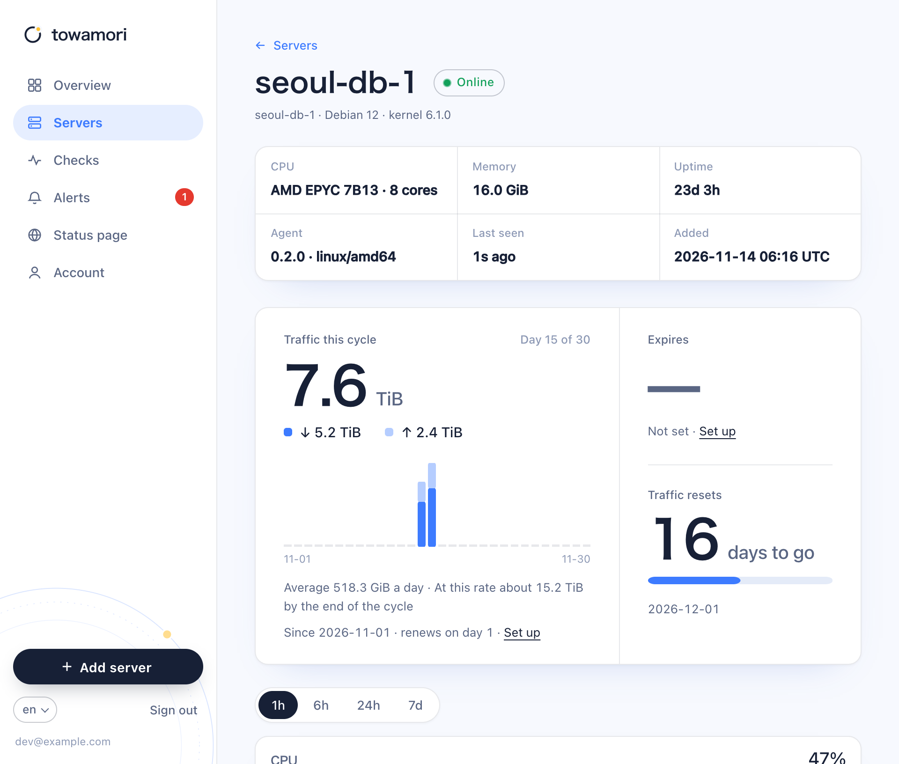
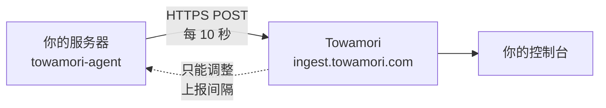

<div align="center">

<picture>
  <source media="(prefers-color-scheme: dark)" srcset="docs/images/banner-dark.svg">
  
</picture>

把 Linux 服务器的 CPU、内存、磁盘和网络发到 [Towamori](https://towamori.com)。

[English](README.md) · **简体中文** · [日本語](README.ja.md) · [한국어](README.ko.md)

</div>

## 安装

1. 在服务器上运行（带 systemd 的 Linux，amd64 或 arm64）：

   ```sh
   curl -fsSL https://app.towamori.com/install.sh | sudo sh
   ```

2. 它会显示一个配对码。在 [Towamori 控制台](https://app.towamori.com)点 **添加服务器**，输入这个码。

就这样。几秒后服务器就出现了，名字就是它的主机名。

写脚本自动装：在 `sudo` 后面加 `TOWAMORI_TOKEN=<token>` 就不用配对码（控制台也能直接生成这种命令）。

再运行一次同样的命令就是升级，原来的设置会保留。

<details>
<summary><b>手动安装</b></summary>

1. 从[最新版本](https://github.com/A1oneSKy/towamori/releases/latest)下载 `towamori-agent_linux_<arch>.tar.gz` 和 `checksums.txt`，用 `sha256sum --ignore-missing -c checksums.txt` 核对。
2. 把二进制文件放到 `/usr/local/bin/`。
3. 把 [`packaging/systemd/towamori-agent.service`](packaging/systemd/towamori-agent.service) 复制到 `/etc/systemd/system/`。
4. 创建 `/etc/towamori/agent.env`，内容为 `TOWAMORI_TOKEN=<your token>`，属主 root，权限 `0600`。
5. 运行 `sudo systemctl enable --now towamori-agent`。

</details>

<details>
<summary><b>Docker（不需要 sudo）</b></summary>

Agent 可以跑在容器里，照样测量宿主机：

```sh
mkdir towamori-agent && cd towamori-agent
base=https://github.com/A1oneSKy/towamori/releases/latest/download
curl -fsSLO $base/towamori-agent_linux_amd64.tar.gz
curl -fsSLO $base/checksums.txt
sha256sum --ignore-missing -c checksums.txt
tar -xzf towamori-agent_linux_amd64.tar.gz towamori-agent
curl -fsSLO https://raw.githubusercontent.com/A1oneSKy/towamori/main/packaging/docker/Dockerfile
docker build -t towamori-agent .

printf 'TOWAMORI_TOKEN=%s\n' '<your token>' > agent.env && chmod 600 agent.env
docker run -d --name towamori-agent --restart unless-stopped \
  --pid host --network host --uts host \
  -v /:/host:ro,rslave -e TOWAMORI_HOST_ROOT=/host \
  --env-file agent.env \
  towamori-agent
```

宿主机的文件系统以只读方式挂载，容器以 `nobody` 身份运行。`TOWAMORI_HOST_ROOT` 告诉 Agent 宿主机的 `/` 挂在哪里，这样它读的是宿主机的挂载表，而不是容器的。

</details>

<details>
<summary><b>查看状态、日志和卸载</b></summary>

```sh
systemctl status towamori-agent
journalctl -u towamori-agent -f
```

卸载：

```sh
sudo systemctl disable --now towamori-agent
sudo rm /etc/systemd/system/towamori-agent.service /usr/local/bin/towamori-agent
sudo rm -r /etc/towamori
sudo systemctl daemon-reload
```

</details>

## 装好之后能看到什么

<picture>
  <source media="(prefers-color-scheme: dark)" srcset="docs/images/console-dark.png">
  
</picture>

<p align="center"><sub>Towamori 控制台里的一台服务器，数据由这个 Agent 上报（演示数据）。</sub></p>

## 它永远不会做的事

- **只往外连。** 不开端口。
- **不能远程控制。** 不执行命令，不碰文件。
- **不需要 root。** 用临时的普通用户运行。
- **只发数字。** 不发进程名、文件或日志。
- **不明文传 token。** 除了 localhost，拒绝用 `http://`。
- **只连 Towamori 自己的地址。** 除了上报，它约每分钟向 Towamori 的各个检测点（`probe.towamori.com` 下的名字）建一次普通 TCP 连接，计时后立刻关掉，不发送任何内容。用 `TOWAMORI_LINKS=off` 可以关闭。
- **只在你点「更新」时才更新，而且只认签名的版本。** 它不会自己更新。你在控制台里点了某台服务器的「更新」后，Agent 才从 Towamori 下载新版本，用内置的公钥验过 Ed25519 签名，再替换自己。`TOWAMORI_UPDATE=off` 可以关掉。
- **下载有校验。** 安装前核对 SHA-256。

<details>
<summary><b>每一条怎么自己验证</b></summary>

| 承诺 | 自己验证 |
|---|---|
| 只往外连。 | `sudo ss -ltnup \| grep towamori` 没有任何输出。 |
| 不能被远程控制。 | 整个协议只有两个 `POST` 请求：[`docs/protocol.md`](docs/protocol.md)（英文）。 |
| 不需要 root。 | [单元文件](packaging/systemd/towamori-agent.service)里的 `DynamicUser=yes`、`ProtectSystem=strict`。 |
| 只发数字，不发数据。 | `towamori-agent --once` 会打印出它要发送的全部内容。 |
| 不明文传 token。 | `towamori-agent -token x -endpoint http://example.com` 会拒绝启动。 |
| 只连 Towamori 自己的地址。 | 拨号前先在代码里校验：只允许 `probe.towamori.com` 下的名字、1024 及以上的端口、不能是内网地址（[`CheckLinkTarget`](protocol/protocol.go)）。`sudo ss -tnp \| grep towamori` 能看到这些连接。 |
| 只在你点「更新」时才更新，只认签名的版本。 | 整个机制就是 [`internal/update`](internal/update)，公钥在 [`statement.go`](internal/update/statement.go)。`journalctl -u towamori-agent` 会记下每一次更新。 |
| 下载有校验。 | 读一下 [`packaging/install.sh`](packaging/install.sh)，很短。 |

</details>

## 更多

<details>
<summary><b>装之前先看看</b></summary>

```sh
curl -fsSLO https://github.com/A1oneSKy/towamori/releases/latest/download/towamori-agent_linux_amd64.tar.gz
tar -xzf towamori-agent_linux_amd64.tar.gz towamori-agent
./towamori-agent --once
```

它会间隔一秒读两次，把 `hello` 和 `report` 的请求体以 JSON 打印出来，不联网。这就是 Agent 会发送的全部内容。（ARM 服务器把 `amd64` 换成 `arm64`。）

<details>
<summary>输出示例（有删节）</summary>

```json
{
  "hello": {
    "protocol": 1,
    "agent": { "version": "0.1.1", "os": "linux", "arch": "amd64" },
    "host": {
      "hostname": "web-1",
      "machine_id": "3f1c9a0e5b7d2c4a8e6f1b3d5a7c9e0f",
      "os_pretty": "Ubuntu 24.04.1 LTS",
      "kernel": "6.8.0-45-generic",
      "cpu_model": "AMD EPYC 7763 64-Core Processor",
      "cpu_cores": 2,
      "memory_total": 2061135872
    }
  },
  "report": {
    "protocol": 1,
    "samples": [
      {
        "ts": 1794200010,
        "cpu": { "usage": 7.5, "user": 5.0, "system": 2.0, "iowait": 0.25, "steal": 0.25 },
        "load": { "l1": 0.12, "l5": 0.08, "l15": 0.05 },
        "mem": { "total": 2061135872, "available": 1288490188, "used": 772645684 },
        "disks": [{ "mount": "/", "fstype": "ext4", "total": 41943040000, "used": 12582912000 }],
        "disk_io": { "read_bps": 0, "write_bps": 40960 },
        "net": { "rx_bps": 2048.5, "tx_bps": 1024.25 }
      }
    ]
  }
}
```

`machine_id` 不是你原始的 `/etc/machine-id`，而是它加盐后的 SHA-256。平台只用它来发现同一个 token 被用在了两台机器上。

</details>

</details>

<details>
<summary><b>工作原理</b></summary>



- **只有两个接口。** 启动时调用一次 `hello`，报告机器的基本信息；之后每读一次就调用一次 `report`。
- **断网不丢数据。** 连不上 Towamori 时，最多在内存里保留 360 次读数（默认间隔下是一小时），恢复后按时间顺序补发，重试间隔按指数退避。
- **刻意做得小而无聊。** 只用 Go 标准库，一个静态二进制文件，没有插件，不会自动更新（只有你在控制台点了「更新」才会更新，而且只更新到 Towamori 签过名的版本）。

</details>

<details>
<summary><b>配置</b></summary>

依次读取命令行参数、环境变量、`/etc/towamori/agent.env`（每行 `KEY=VALUE`）。

| 参数 | 环境变量 | 默认值 | |
|---|---|---|---|
| `-token` | `TOWAMORI_TOKEN` | | 控制台里拿到的 Agent token，必填。 |
| `-endpoint` | `TOWAMORI_ENDPOINT` | `https://ingest.towamori.com` | 指标发往哪里。 |
| `-interval` | `TOWAMORI_INTERVAL` | `10s` | 采集间隔，5s 到 300s。你的套餐可能会设定不同的间隔。 |
| `-env-file` | | `/etc/towamori/agent.env` | 文件不存在时忽略。 |
| `-host-root` | `TOWAMORI_HOST_ROOT` | `/` | 在容器里运行时，宿主机的 `/` 挂载在哪里。 |
| `-links` | `TOWAMORI_LINKS` | `on` | 每分钟测一次到 Towamori 各检测点的连接耗时（`on` 或 `off`）。 |
| `-update` | `TOWAMORI_UPDATE` | `on` | 允许控制台把这个 Agent 更新到更新的签名版本（`on` 或 `off`）。需要 systemd 方式安装（Docker 方式不行）。 |
| `-once` | | | 读一次、打印、退出。不需要 token，也不联网。 |
| `-print` | | | 同时把每个请求体打印到标准输出。 |
| `-version` | | | 打印版本号后退出。 |

> [!TIP]
> 把 token 放在 env 文件里（安装脚本就是这么做的），不要用 `-token` 写在命令行上：命令行参数通过 `ps` 对这台机器上的所有用户可见。

Agent 遵循标准的 `HTTPS_PROXY` 和 `NO_PROXY` 环境变量。

</details>

<details>
<summary><b>采集哪些数据</b></summary>

| 类别 | 字段 | 读取来源 |
|---|---|---|
| 主机（启动时一次） | 主机名、系统名称和版本、内核、CPU 型号、核数、内存大小、开机时间、`/etc/machine-id` 加盐后的哈希 | `/proc/sys/kernel/*`、`/etc/os-release`、`/proc/cpuinfo`、`/proc/meminfo`、`/proc/stat`、`/etc/machine-id` |
| CPU | 使用率、user、system、iowait、steal（%） | `/proc/stat` |
| 负载 | 1、5、15 分钟平均负载 | `/proc/loadavg` |
| 内存 | 总量、可用、已用、swap 总量、swap 已用 | `/proc/meminfo` |
| 磁盘 | 每个真实文件系统：挂载点、类型、总量、已用、可用、inode | `/proc/self/mounts`、`statfs(2)` |
| 磁盘 I/O | 所有物理磁盘的读写字节/秒 | `/proc/diskstats` |
| 网络 | 每块网卡的收发字节/秒，以及总计（VPN 隧道会列出，但不重复计入） | `/proc/net/dev` |
| 其他 | 运行时长、进程数（只是个数，不是列表） | `/proc/uptime`、`/proc` |

完整的数据格式逐字段写在 [`docs/protocol.md`](docs/protocol.md)（英文）。指标只在 Linux 上采集；在其他系统上 Agent 也能运行（方便开发），但只发送主机信息。

</details>

<details>
<summary><b>从源码构建</b></summary>

只需要 Go 1.22 或更新版本：

```sh
make test     # go vet + 开竞态检测跑测试
make build    # 为本机构建 bin/towamori-agent
make dist     # dist/：linux/amd64 和 linux/arm64 静态包 + checksums.txt
```

发布用的二进制由 [GitHub Actions](.github/workflows/release.yml) 用当前稳定版 Go 构建。

</details>

<details>
<summary><b>对接本地服务器开发</b></summary>

`towamori-devserver` 是一个小小的平台替身：按协议检查每个请求，每条读数打印一行。

```sh
go run ./cmd/towamori-devserver -token dev
go run ./cmd/towamori-agent -env-file "" -endpoint http://127.0.0.1:8787 -token dev
```

</details>

## 贡献、安全、许可证

- 欢迎贡献。请先读 [CONTRIBUTING.md](CONTRIBUTING.md)（英文）：不加新依赖，不加新能力。
- 发现漏洞请按 [SECURITY.md](SECURITY.md)（英文）私下报告，不要开公开 issue。
- 代码以 [Apache License 2.0](LICENSE) 授权。
- “Towamori”名称和标志不在该许可证范围内，见 [TRADEMARKS.md](TRADEMARKS.md)（英文）。

<br>

<div align="center">
<sub><b>towa</b> 永遠 — 永远 &nbsp;·&nbsp; <b>mori</b> 守り — 守护</sub>
</div>
